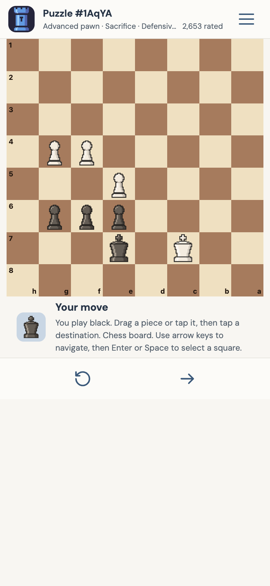
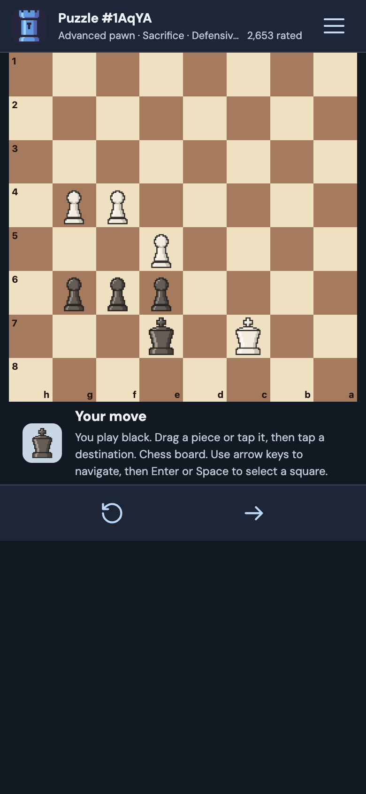

<p align="center">
  
</p>

<h1 align="center">Tactirook</h1>

<p align="center">
  A focused, open-source chess tactics trainer.<br>
  Practice a little. See a little further.
</p>

<p align="center">
  <a href="https://github.com/Solenia13/ChessTrainer/actions/workflows/ci.yml"></a>
  <a href="./LICENSE"></a>
  
</p>

<p align="center">
  <a href="https://solenia13.github.io/ChessTrainer/">Web preview</a> ·
  <a href="#getting-started">Run locally</a> ·
  <a href="./CONTRIBUTING.md">Contribute</a> ·
  <a href="https://github.com/Solenia13/ChessTrainer/issues">Report a bug</a>
</p>

## Availability

Tactirook is under active development. The web preview may change and is not
a stable release.

| Platform | Status |
| --- | --- |
| Web | Preview deployed from `main` through GitHub Pages after CI succeeds |
| iOS | **Not published on the App Store yet.** Native preparation and testing are in progress. |
| Android | **Not published on Google Play yet.** Native preparation and testing are in progress. |

There are no official store download links or announced mobile release dates.
You can run the source with Expo while development continues. Successful exports
are not a substitute for testing on physical devices or store review.

## What you can do

- Train with **443,224 distinct Lichess puzzles** across **73 themes**.
- Mix themes, search categories and practice without revealing puzzle type or rating.
- Move pieces by dragging or tapping; use hints, restart, or move to the next puzzle.
- Practice unseen puzzles first, or allow repeats. Progress stays on your device.
- Switch between light/dark themes, three board palettes and six piece sets,
  including the original **Signature** pixel-art set.
- Keep your language, appearance and training settings between sessions.
- Use the interface in **English, French, Spanish, Italian, Japanese,
  Simplified Chinese or Hindi**. The first launch follows your device language.
- Use keyboard board navigation on web, accessible square labels and reduced-motion support.

The app does not require an account or a Lichess API connection during play.
On the web, uncached puzzle files still need a network connection to the hosting
site; this is **not a fully offline PWA**.

## Preview

<p align="center">
  
  
</p>

Responsive **web** previews with the Signature piece set. These are not
screenshots of published iOS or Android builds.

## Getting started

Use **Node.js 24 LTS** and npm. The required version is recorded in [`.nvmrc`](./.nvmrc).

```sh
git clone https://github.com/Solenia13/ChessTrainer.git
cd ChessTrainer
npm ci
npm start
```

Open the project with a compatible Expo Go installation on the same network,
or run one of these commands:

```sh
npm run web
npm run ios
npm run android
```

The iOS simulator requires macOS and Xcode; Android emulation requires the
Android SDK and an emulator. These commands start development builds, not
store-ready releases. See the [development guide](./docs/DEVELOPMENT.md).

## Development checks

```sh
npm run typecheck
npm run lint
npm test
npx expo export --platform all
```

[CI](./.github/workflows/ci.yml) checks types, lint, tests, reproducible artwork
and the web export on pull requests. Successful pushes to `main` also publish
the web preview. The repository name and `/ChessTrainer` base path are retained
for that deployment; the app's public name is **Tactirook**.

The complete, slower puzzle-data verification can be run with
`npm run verify:puzzles` or the
[manual verification workflow](./.github/workflows/verify-puzzles.yml).

## Project guide

| Topic | Documentation |
| --- | --- |
| Setup, architecture, artwork and release preparation | [Development](./docs/DEVELOPMENT.md) |
| Puzzle source, storage, import and verification | [Puzzle library](./docs/PUZZLE_LIBRARY.md) |
| Local storage and network behavior | [Privacy](./docs/PRIVACY.md) |
| Changes in progress | [Changelog](./CHANGELOG.md) |
| Bug reports, translations and pull requests | [Contributing](./CONTRIBUTING.md) |
| Community expectations | [Code of conduct](./CODE_OF_CONDUCT.md) |
| Reporting vulnerabilities privately | [Security policy](./SECURITY.md) |
| Asset origins and license exceptions | [Third-party notices](./THIRD_PARTY_NOTICES.md) |

## Accessibility

The board supports tap and drag controls, screen-reader square labels, keyboard
navigation on web (arrows, Enter/Space), visible focus and reduced motion.
Dialogs manage focus, and layouts can scroll with enlarged text or short screens.

Accessibility is ongoing work. **Full WCAG conformance is not claimed**;
VoiceOver and TalkBack testing on real devices is still needed. Please report
barriers with your platform, assistive technology and reproduction steps.

## What's next

- Test and refine the native experience on physical iOS and Android devices.
- Prepare signing, application identifiers, release builds and store listings.
- Complete mobile privacy/accessibility checks and release-specific dependency notices.
- Publish official mobile versions once they are ready.

These are development goals, not delivery commitments.

## Contributing and stewardship

Tactirook is maintained by [Solenia13](https://github.com/Solenia13).
Bug reports, translations, accessibility feedback and focused pull requests are
welcome. Start with [CONTRIBUTING.md](./CONTRIBUTING.md); discuss substantial
changes before implementing them.

Forks are welcome under the license. Please clearly identify independently
maintained builds rather than implying they are official Tactirook releases.

## License and credits

Tactirook's original code, documentation and artwork are licensed under
**[GNU GPL version 3 or later](./LICENSE)** (`GPL-3.0-or-later`).
This includes the Tactirook icon and the Signature and Atelier piece sets.
See [NOTICE](./NOTICE) for scope and copyright information.

Third-party assets and dependencies **retain their own licenses**:

- Puzzles: [Lichess database](https://database.lichess.org/#puzzles), CC0.
- Celtic, Fantasy and Spatial: Maurizio Monge, MIT.
- Chessnut: Alexis Luengas, Apache 2.0.
- DM Sans and DM Serif Display: SIL Open Font License 1.1.
- Expo starter: original MIT notice preserved.

Full details, source revisions and notice locations are in
[THIRD_PARTY_NOTICES.md](./THIRD_PARTY_NOTICES.md). Historical licenses still
apply to assets in earlier versions. Tactirook is an independent project,
not an official Lichess application.
